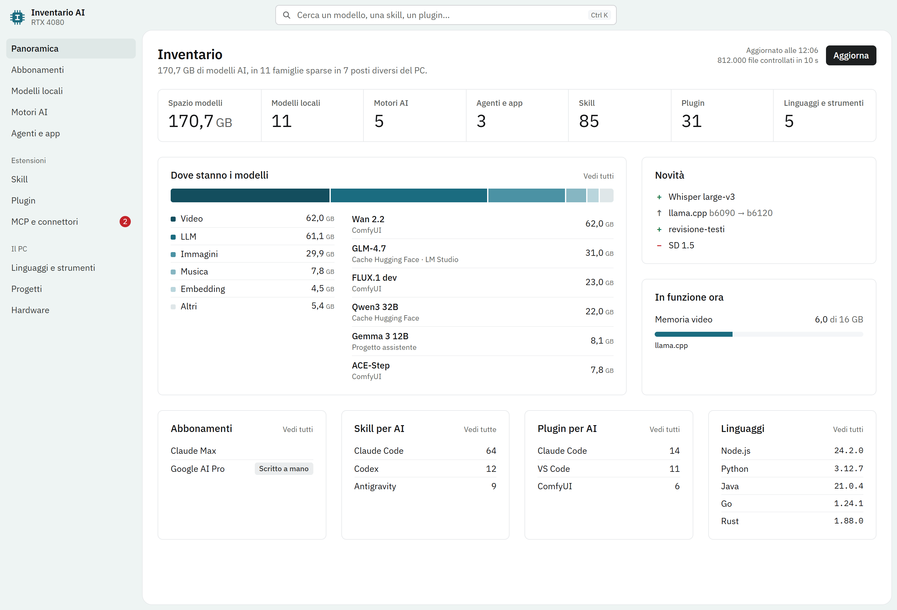
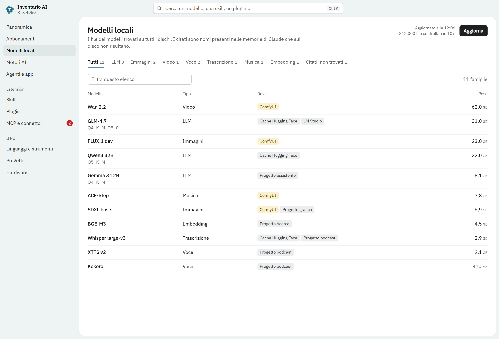

# ScarvaInventoryAI

**Hai installato di tutto per l'AI. Adesso puoi sapere cosa, dove e quanto pesa.**

Una pagina che gira sul tuo computer e raccoglie in un posto solo modelli locali, motori, agenti, skill, plugin, MCP, linguaggi e abbonamenti. Si aggiorna ogni volta che la apri.



<sub>Schermata con dati di esempio.</sub>

## Il problema

Con l'AI si installa tanto e in fretta. Un modello scaricato per un progetto, un ambiente Python per provarne un altro, una skill per Claude, un plugin per Codex, un motore vocale preso da GitHub. Dopo qualche mese nessuno ricorda più cosa ha sul disco.

Intanto i modelli occupano decine di gigabyte in cartelle nascoste, e ogni AI tiene le sue estensioni in un posto diverso. Un elenco unico non esiste, e rifarlo a mano è impossibile.

## Perché è nata

È nata su un PC usato ogni giorno per lavorare con l'AI, dove le cose installate erano ormai fuori controllo. La scansione di quel computer ha trovato **42 famiglie di modelli per 284 GB, sparse in 11 posti diversi**, più 275 skill, 58 plugin e 31 tra server MCP e connettori. Una parte stava dentro le cartelle dei singoli progetti, dove nessuno sarebbe andato a cercarla.

## Cosa trova

| Sezione | Cosa ti dice |
| --- | --- |
| **Modelli locali** | GGUF, safetensors, ONNX e cache Hugging Face, con peso e cartella, su tutti i dischi |
| **Motori AI** | ComfyUI, llama.cpp, whisper.cpp, Ollama, librerie come faster-whisper e tutti gli ambienti Python |
| **Agenti e app** | Claude Code, Codex, Antigravity, Copilot e le altre app AI, con la versione |
| **Skill** | Quali hai e per quale AI sono installate |
| **Plugin** | Per Claude Code, Codex, Antigravity, VS Code, ComfyUI e Obsidian |
| **MCP e connettori** | Quali sono collegati e quali aspettano un'autorizzazione |
| **Abbonamenti** | Claude e Codex vengono rilevati da soli, il piano Google te lo chiede una volta alla prima apertura |
| **Linguaggi e strumenti** | Node, Python, Java, Git, FFmpeg e il resto, con la versione |
| **Progetti** | Incrocia le memorie di Claude con il disco e ti segnala i modelli citati che non si trovano più |
| **Hardware** | Scheda video, memoria, dischi, porte AI in ascolto |



<sub>Schermata con dati di esempio.</sub>

## Come funziona

1. **Doppio clic.** Si apre una pagina nel browser, con gli ultimi dati già pronti.
2. **Lui guarda il disco.** Su Windows controlla più di un milione di file in una decina di secondi.
3. **Tu trovi tutto.** Cerchi per nome, filtri, apri la cartella con un clic. La sezione Novità ti dice cosa è stato aggiunto, aggiornato o rimosso dall'ultima volta.

Quando chiudi la pagina, il programma si spegne da solo.

## Perché dovresti averla

- **Liberi spazio sapendo cosa pesa**, invece di cancellare alla cieca.
- **Smetti di riscaricare** modelli che hai già in un'altra cartella.
- **Sai cosa è acceso**: quali motori girano e quali porte sono in ascolto.
- **Controlli cosa hai concesso alle tue AI**: plugin, skill e MCP, divisi per agente.
- **Cambi computer senza dimenticare niente**, perché hai la lista di quello che ti serve.

## I tuoi dati restano tuoi

Il programma legge soltanto: non modifica e non cancella nulla, e scrive solo nella propria cartella. Non invia niente a nessuno: niente account, niente cloud, niente telemetria. Ascolta solo su `127.0.0.1` e non apre mai i file delle credenziali (`.credentials.json`, `auth.json`, `oauth_creds.json`, `.env`). Di MCP e connettori salva solo i nomi.

## Installazione

Serve [Node](https://nodejs.org) 22 o più recente, nient'altro.

```
git clone https://github.com/Scarva99/ScarvaInventoryAI.git
```

- **Windows:** doppio clic su `Avvia Inventario.vbs`.
- **macOS:** doppio clic su `Avvia Inventario.command`. La prima volta macOS chiede il permesso di leggere Documenti, Scrivania e Download: senza, quelle cartelle restano fuori dall'inventario. Per un controllo completo aggiungi Terminale in Impostazioni di Sistema, Privacy e sicurezza, Accesso completo al disco.

> Il supporto per macOS è nuovo e non è ancora stato collaudato su un Mac vero. Se qualcosa manca o non torna, apri una segnalazione.

Per aggiornare il programma: `git pull` nella cartella.

## Personalizzazione

- **`dichiarato.json`** contiene ciò che il computer non può rilevare, come la risposta sul piano Google, che puoi cambiare dalla sezione Abbonamenti. Viene creato alla prima scansione a partire da `dichiarato.esempio.json` e resta solo sul tuo computer.
- **`scanner/models.mjs`**, nell'elenco `RULES`, contiene i nomi dei modelli noti. Un modello che non corrisponde a nessuna regola compare comunque, col nome del file.

## Limiti della scansione

Salta sempre le cartelle `node_modules` e `.git` e quelle protette dal sistema. Il numero di quelle saltate è nella sezione Hardware.

- **Windows:** legge tutti i dischi fissi, tranne `C:\Windows`.
- **macOS:** legge la cartella utente, `/Applications`, `/Library/Application Support`, `/opt`, `/usr/local` e i dischi esterni collegati. Salta le cartelle cloud in `~/Library/CloudStorage`.

## Crediti

I caratteri IBM Plex sono distribuiti con licenza SIL Open Font License 1.1, in `public/fonts/OFL.txt`.
